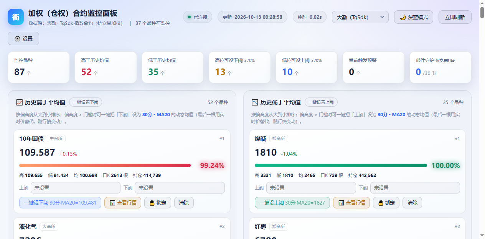
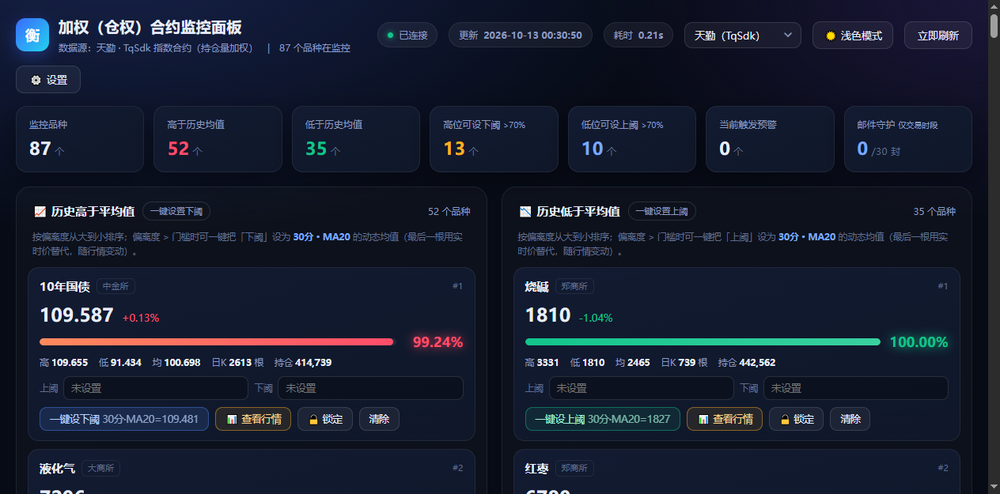
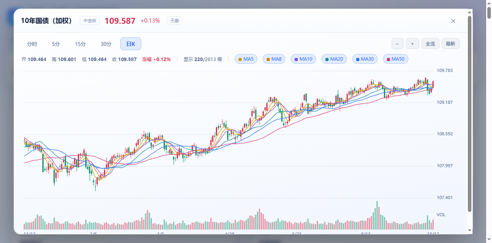
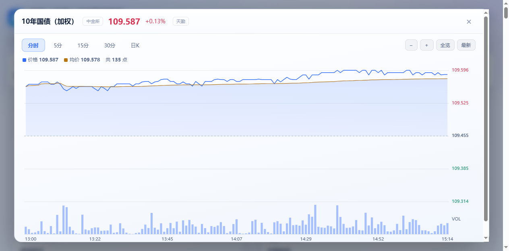
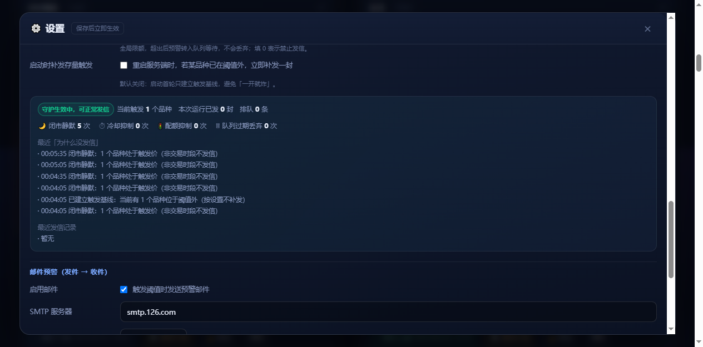
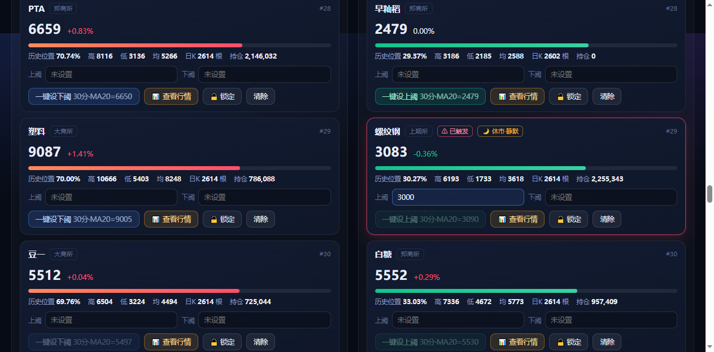

<p align="center"></p>

# 加权（仓权）合约监控面板 · 曲合 / 天勤 双数据源

> 用**加权（持仓量加权）合约**数据，一屏监控全市场 **88** 个期货品种相对**历史均价**的偏离度；
> 偏离越极端越靠前，一键把阈值设到该周期的动态均线，越界即刻预警并邮件推送 —— 内置五层防轰炸守护。

**Python（标准库）+ 单文件 HTML，零第三方依赖**（天勤源为可选增强）。

[](https://chenzhuanxin.github.io/futures-weighted-panel/)
[](https://github.com/chenzhuanxin/futures-weighted-panel/releases/latest)
[](#快速开始)
[](#数据源一览)

| 在线文档 | 地址 |
|---|---|
| 🏠 项目首页 | <https://chenzhuanxin.github.io/futures-weighted-panel/> |
| 📖 详细使用说明 | <https://chenzhuanxin.github.io/futures-weighted-panel/usage.html> |
| 🔍 详细数据源说明 | <https://chenzhuanxin.github.io/futures-weighted-panel/datasource.html> |
| 📦 Release 下载 | <https://github.com/chenzhuanxin/futures-weighted-panel/releases> |

---

## 快速开始

### 方式 A：单文件 EXE（推荐）

从 [Releases](https://github.com/chenzhuanxin/futures-weighted-panel/releases/latest) 下载
`futures-weighted-panel-v1.0.0-win64.exe`（约 94 MB），**双击即用**：

1. 双击运行（单文件 EXE 先自解压，约 5~10 秒后弹出控制台窗口）
2. 浏览器自动打开 `http://127.0.0.1:8689`（端口被占自动避让到 8690…）
3. 首次启动预热 20~60 秒（拉取全部品种历史日K），预热完刷新即可

> ✅ EXE 默认数据源为**曲合网**（**免账号、免密钥**，82 个品种有行情，日K 约 3.5 年）—— 双击就有数据。

### 方式 B：源码运行

```bash
# 下载源码包或 git clone 后
python 服务端.py            # 默认 8689 端口
# 或 Windows 下直接双击
启动看板.bat
```

源码运行只需 **Python 3.9+ 标准库**；仅当使用天勤数据源时才需要 `pip install tqsdk`。

> 启动顺序已优化：服务端**先监听端口、再后台预热**历史日K，打开即刻可访问，不会出现 `ERR_CONNECTION_REFUSED`。

## 核心能力

| # | 能力 | 说明 |
|---|---|---|
| 1 | **偏离度排序** | 以历史均价 M 为 0 基准，高低两侧各自归一化到 0~100%，越极端越靠前 |
| 2 | **一键设阈** | 把上/下阈直接设成所选周期（5分/15分/30分/日K）MA 的**动态均值**（最后一根用实时价替代，每个 tick 都在变） |
| 3 | **全量 K 线** | 一次取回该周期全部 K 线，本地切片缩放平移，滚轮到任意位置都不再请求 |
| 4 | **实时分时** | 2 秒一档实时价驱动主面板；图表最后一根 K 线用实时价重绘 |
| 5 | **双源热切换** | 顶栏下拉即切曲合 ↔ 天勤，切换后历史 H/L/M 自动按新源重算 |
| 6 | **五层防轰炸** | 边沿触发＋滞回复位＋交易时段门禁＋冷却＋全局配额，一天不再 720 封 |
| 7 | **双主题** | 浅色（默认）与深蓝一键互切，Canvas 图表配色同步切换 |
| 8 | **条右侧偏离度** | `bar-container + percent-label` 结构，偏离度 > 70% 加粗高亮并解锁一键设阈 |
| 9 | **单文件 EXE** | PyInstaller 打包，内置 tqsdk / pandas / numpy / scipy，拷到任意目录即可运行 |

## 界面预览

| 浅色主界面（默认） | 深蓝模式 |
|---|---|
|  |  |

| 日K · 6 条均线 + 阈值虚线 | 分时图 |
|---|---|
|  |  |

| 防轰炸守护设置 | 休市静默标记 |
|---|---|
|  |  |

更多截图见在线文档与 `截图/` 目录。

## 数据源一览

| 数据源 | 账号 | 加权口径 | 品种数 | 日K 回溯 | 分钟K 上限 | 特点 |
|---|---|---|---|---|---|---|
| **曲合网**（金投网） | 免账号 | `JO_xxxxxx` 加权合约 | 88（有行情 82） | 约 3.5 年 | 单次 500 根 | 秒开、无会话问题 |
| **天勤** TqSdk | 需快期账号 | `KQ.i@交易所.品种` 指数合约 | 87 | 2016 年起（10 年+） | 4000 根 | 历史深、推送式实时 |

两者**口径一致**（均为持仓量加权），切换后历史 H/L/M 会自动按新源重算。
详细的接口、88 品种映射总表、覆盖差异原因（5 个郑商所僵尸品种）请看
[数据源说明](https://chenzhuanxin.github.io/futures-weighted-panel/datasource.html)。

## 预警与防轰炸守护

触发条件：实时价**上穿**上阈 或 **下穿**下阈 → 卡片红色高亮 + 提示音 + 邮件。

| 层 | 机制 | 作用 |
|---|---|---|
| ① 边沿触发 | 只有「从阈内穿到阈外」的那一刻才算一次事件 | 一次突破只发一封 |
| ② 滞回复位 | 回落超过上阈 ×(1−0.3%) 才复位 | 滤掉阈值边缘抖动 |
| ③ 交易时段门禁 | 闭市期间完全不发信、不置位触发态 | 解决整夜 / 周末轰炸 |
| ④ 同品种冷却 | 同品种同方向 600 秒内最多一封 | 兜底限频 |
| ⑤ 全局配额 | 每小时 ≤ 6 封、每天 ≤ 30 封，超出转排队 | 上限兜底 |

交易时段判定首选「**行情数据新鲜度**」（行情时间戳即最新交易时刻），零维护地自动适配
夜盘差异（沪铜到 01:00 / 螺纹钢到 23:00）、节假日与临时休市。

## 目录结构

```
futures-weighted-panel/
├── 服务端.py            # 纯标准库 HTTP 服务 + 统计 + 预警引擎 + 按源缓存
├── 看板.html            # 单文件前端（自绘 Canvas 图表，零 CDN 依赖）
├── 数据源.py            # 数据源路由（单例、切换、状态）
├── 曲合行情.py          # 曲合网数据源（实时/分时/分钟K/日K）
├── 天勤行情.py          # 天勤数据源（子线程 Actor + 任务队列）
├── 邮件预警.py          # 卡片式 HTML 预警邮件
├── 品种表.py            # 88 个品种的 曲合 ↔ 天勤 双源映射
├── 配置示例.json        # 脱敏配置模板（复制为 缓存/配置.json 使用）
├── 启动看板.bat         # Windows 双击启动
├── 打包exe.py           # 一键打包单文件 EXE（产物输出到 发布/）
├── 说明.md              # 完整说明（与在线文档同源）
├── docs/                # GitHub Pages 在线文档（index / usage / datasource）
├── 截图/                # 界面截图
└── 发布/                # EXE 使用说明（EXE 本体走 Release 分发）
```

## 配置与数据

所有配置保存在本机 `缓存/` 目录（**不会**上传到任何服务器，也不会被提交进本仓库）：

```
缓存/配置.json          面板设置、数据源、天勤账号、邮件参数
缓存/阈值设置.json       各品种上阈 / 下阈 / 锁定状态
缓存/曲合日K缓存.json    曲合源日K缓存（可删，会自动重建）
```

想预填参数可把仓库里的 `配置示例.json` 复制为 `缓存/配置.json` 再修改（不含任何账号，需自行填写）。

## 重新打包 EXE

```bat
C:\Python314\python.exe 打包exe.py      :: 产物 → 发布\加权合约监控面板.exe（约 94 MB）
```

打包要点（含踩坑记录：`--hidden-import` 中文模块、`--add-data` 绝对路径、不能排除 `pydoc`）见
[在线文档 · 重新打包](https://chenzhuanxin.github.io/futures-weighted-panel/usage.html#repack)。

## 免责声明

- 本项目为**个人学习与研究用途**的开源工具，数据来自第三方公开接口。
- 数据可能存在延迟、缺失或错误，**不构成任何投资建议**，据此交易所产生的盈亏由使用者自行承担。
- 数据源接口可能随时变更，届时需相应调整 `曲合行情.py` / `天勤行情.py`。
- 请遵守各数据源的服务条款，控制请求频率。

---

设计：**公歧子**　微信：**gongqizi0**
